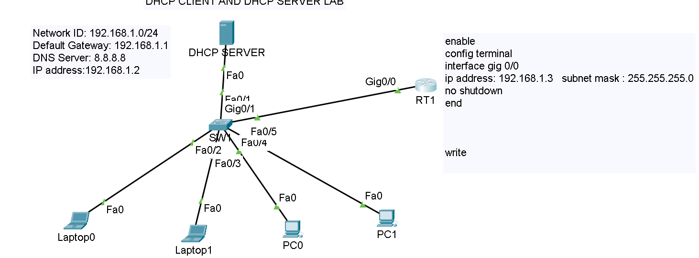

# DHCP Client Server Lab
Cisco Packet Tracer lab configuring a DHCP server, router interface (Gig0/0), switch, and end devices on the 192.168.1.0/24 network.

A [Cisco Packet Tracer](https://www.cisco.com/c/en/us/training-events/training-certifications/training/packet-tracer.html) networking lab demonstrating dynamic IP address assignment across a `192.168.1.0/24` subnet using a dedicated DHCP Server, a Cisco Router (`RT1`), a Layer 2 Switch (`SW1`), and client hosts (`PC0`, `PC1`, `Laptop0`, `Laptop1`).

## Repository Contents

* `dhcp-client-server-lab.pkt` — Saved Cisco Packet Tracer lab topology and device configurations
* `topology.png` — Network topology and addressing diagram
* `README.md` — Lab documentation, addressing table, and CLI commands

## Network Topology



## IP Addressing & Network Parameters

* **Network ID:** `192.168.1.0/24`
* **Subnet Mask:** `255.255.255.0`
* **Default Gateway:** `192.168.1.1`
* **DNS Server:** `8.8.8.8`

| Device | Interface | IP Address | Subnet Mask | Assignment |
| :--- | :--- | :--- | :--- | :--- |
| **DHCP Server** | `Fa0` | `192.168.1.2` | `255.255.255.0` | Static |
| **RT1** | `Gig0/0` | `192.168.1.3` | `255.255.255.0` | Static |
| **SW1** | `Fa0/1`–`Fa0/5`, `Gig0/1` | — | — | Layer 2 Switch |
| **Laptop0** | `Fa0` | Assigned via DHCP | `255.255.255.0` | Dynamic (DHCP) |
| **Laptop1** | `Fa0` | Assigned via DHCP | `255.255.255.0` | Dynamic (DHCP) |
| **PC0** | `Fa0` | Assigned via DHCP | `255.255.255.0` | Dynamic (DHCP) |
| **PC1** | `Fa0` | Assigned via DHCP | `255.255.255.0` | Dynamic (DHCP) |

## Device Configuration

### Router (`RT1`) CLI Commands

```cisco
enable
configure terminal
interface gigabitEthernet 0/0
ip address 192.168.1.3 255.255.255.0
no shutdown
end
write
